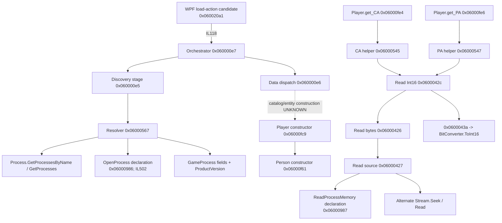

# FMRTE 13 — recovered load and read paths

**Primary target:** <FMRTE13_INSTALL_ROOT>\FMRTE.exe, file/assembly 13.3.3.62, SHA-256 c3d594ed4d9d2c50e987a36ed186d771dd4242450c7e75fc34920e5d8dbcfcae, MVID 3a4eebcf-0c16-4aa7-9cf2-ae0de96d1ec6, x86 .NET Framework 4 Client. All observations below are static CIL/metadata from REA, not an executed game load.

## Evidence aliases and scope

| Alias | REA canonical Evidence ID | Exact selection |
|---|---|---|
| UI13 | ev_19d6493a09e757902f03760129ec67af7895156afb13a82920a23c0dba3abdd9 | Obfuscated main WPF type, 240 methods |
| L13 | ev_45f9c6ba99e4642ef18454556e7278b63309b05a125e9d485ea294962b5b32ab | Loader/orchestrator type, 17 methods |
| D13 | ev_dff3bf9248a5ceb00baaf8e26b4ed3cf8ea6408523d5782cec2f2b4ee599f71a | Process/stream discovery type, 10 methods |
| P13 | ev_340c303fb209860b2edfef989acbd316b43a87e77ce976e9cc140b9bce1bb832 | Player, Person, GameProcess |
| CA13 | ev_4c35ddf55fba55ed58f57ef3f0e9ee65aac8da5f0e66b258ae27229dc806586a | CA/PA helper type, 7 methods |
| M13 | ev_d0607aba2a6662460bffc27f6f15f37c637e82c2901872eb3746bc20e63eacaa | Common read/write helpers, 44 methods |
| A13 | ev_b1e0fe0f79217cb812c740acf46ecf1a99b7b79ab46d067e2aa01a51ef80742d | TechnicalAttributes, PhysicalAttributes, Positions, HiddenAttributes |
| B13 | ev_f6833f0e33bc70ec47da48762a36ae2cdf5f9019b7c77653d1ea0c774ff75259 | P/Invoke declarations for entire assembly |

Each selected producer reports complete metadata/CIL coverage within that selection. call_edges include call, callvirt, newobj and ldftn; a present reference does not prove that an obfuscated branch runs.

## Process discovery and game loading

**CONFIRMED:** main WPF method 0x060020a1 (RVA 1114712) resets loaded/UI state and calls loader 0x060000e7 at IL118. The latter calls 0x060000e5 (IL11), which calls process resolver 0x06000567 (IL51). Root 0x06002104 also holds an ldftn reference to 0x060020a1. **INFERRED:** 0x060020a1 is a load-action handler; its obfuscated name and unexecuted binding mean the exact toolbar-control identity is not certified.

**CONFIRMED:** resolver 0x06000567 (RVA 193848) contains calls to Process.GetProcessesByName (four sites), Process.GetProcesses, Process.MainWindowTitle, Process.Handle/Id, and P/Invoke OpenProcess 0x06000986 at IL502. It assigns GameProcess.Pointer/Process/BaseAddress/VersionDescription/FileName and reads MainModule.FileVersionInfo.ProductVersion. These are direct calls, stronger evidence than imports alone.

**UNKNOWN:** decoded process-name/window-title strings, exact requested access rights, runtime-selected process, compatibility whitelist, per-build signatures/absolute offsets, error-path behavior and successful attachment. ProductVersion access establishes version inspection, not a validated ManagerHub build registry.

**CONFIRMED:** orchestrator 0x060000e7 calls 0x060000e6 after its discovery-stage references. That method dispatches through other obfuscated managed helpers. The complete object-catalog construction between this dispatcher and individual Player wrappers has not been recovered. Exceptions/logging calls are present; their real outcomes were not tested.

## Confirmed static graph

Solid edges are CIL references, not a claim of runtime order; dotted links are unrecovered relationships.

**CONFIRMED:** M13 method 0x06000427 calls GameProcess.get_Pointer before its ReadProcessMemory reference and also contains monitor-protected Stream.Seek/Read references. D13 method 0x06000566(string) tests file existence, constructs FileStream and stores a stream field. **UNKNOWN:** the alternate file's format/extension/origin and its complete selection semantics. This is not proof of an offline .fm parser.

## Player identities and fields

| Field / wrapper | Confirmed static representation/path | Remaining unknown |
|---|---|---|
| Player constructor | 0x06000fc9 takes i4; delegates to Person and retains an address-like field, constructs CA/PA helper | Native record base, generation and entity identity |
| Person ID | get_ID 0x06000f63 returns i4; references field 0x040008e3 and helper 0x0600042d -> Int32 conversion | Real UID versus other native identity; exact field location |
| Actual CA candidate | Player.get_CA 0x06000fe4 -> 0x06000545 -> 0x0600042c -> 0x06000426/27 -> ReadProcessMemory branch; returns i2 | Exact build-specific address, decoded value, repeat consistency and equivalence to trusted game's CA |
| Actual PA candidate | Player.get_PA 0x06000fe6 -> 0x06000547 -> same Int16 helper | Same validation gaps; PA conventions/ranges not established |
| Passing / Pace | TechnicalAttributes.get_Passing 0x060012e6 / PhysicalAttributes.get_Pace 0x06000fc1 return i1; read helper 0x0600042e then conversion 0x060008ed | Raw-to-visible conversion formula, scale and per-build field |
| Positions / hidden attributes | Separate exact declaring types admitted by A13 | No validated native field map or game values |
| Names, birth, nation | Person getters and UI reads appear in P13/pages evidence | No independent same-build extraction/encoding validation |
| Club linkage / complete player catalog | UNKNOWN | No end-to-end recovered native graph or real fixture |

**CONFIRMED:** CA/PA getters load helper field 0x040008f7. CA/PA helpers access distinct static field tokens (CA includes 0x0400069d/683/154, PA 0x0400069e/685/155) and several selector/conversion methods. **INFERRED:** configurable/version-dependent layout selection. **UNKNOWN:** the selected values and mapping of each table to a precise FM build. A field token is not an offset.

**CONFIRMED:** ordinary visible attribute methods use signed-byte read helpers plus an additional conversion, whereas CA/PA use Int16 paths. Do not copy a visible 1–20 scale onto raw storage or apply CA/PA encoding to all attributes.

## Conclusion and next probe

**CONFIRMED static conclusion:** this FMRTE13 assembly has a player CA/PA read path reaching process-memory API calls and an independent stream alternative. **UNKNOWN:** successful local FM2013 reads, exact native layout, cache invalidation/reload behavior and complete UI-to-catalog link. ManagerHub may use the separation of source/build/session/field decoding as design evidence; it cannot enable a reader from these tokens.

Follow-up: the user-supplied [local executable](10-local-fm2013-executable.md) now has recorded metadata `13.3.3f359652` and a SHA-256; [a new test save](11-fm2013-save-samples.md) is identified and its experimental container index inspected. Next obtain known-player ground truth, identify the applicable layout without bypassing protections, validate identity, read twice, compare actual CA/PA and test process exit. A controlled same-career pair is separately necessary for offline field-difference work. Executable/index identification alone does not resolve the layout or player reader test.
## Deep follow-up

Subsequent REA work recovers [profile selection and mutable layout slots](12-fm2013-build-profile.md), the [alternate read-only file source](13-fmrte13-stream-source.md), [numerically verified field transforms](14-fmrte13-field-transforms.md) and [catalog-to-Player construction](15-fmrte13-player-catalog.md). The catalog report identifies pointer-table/list traversal and profile type-marker checks; exact local-build roots and the UI scheduling link remain unresolved.
