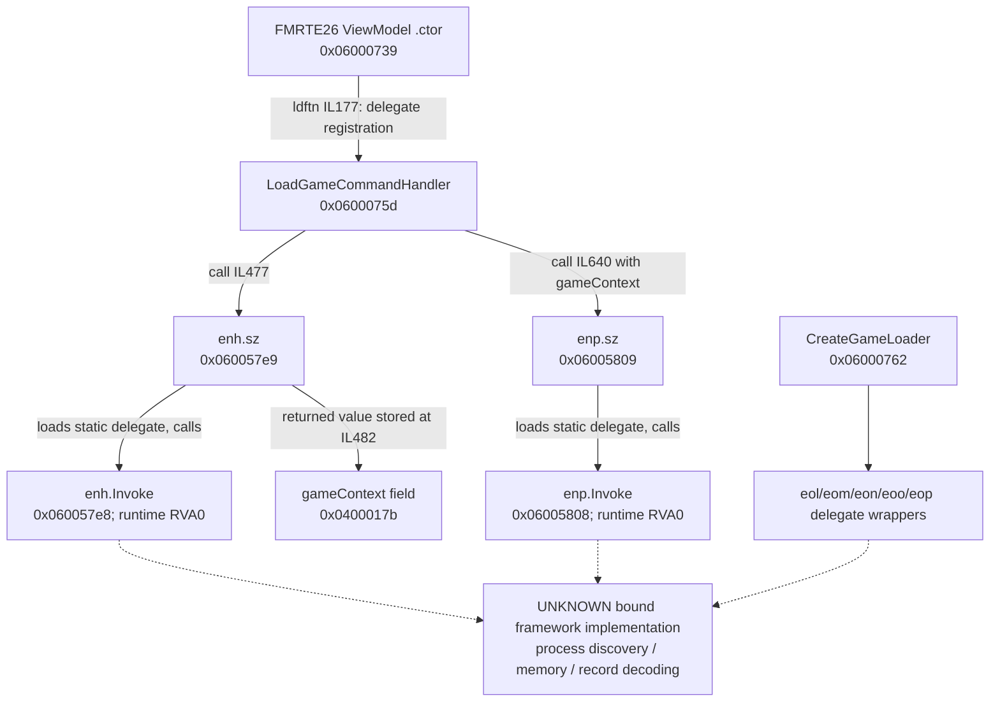

# FMRTE 26 — Load Game: recovered static path

Research date: 2026-10-30. Secondary comparison only; these findings do not establish FM2013 compatibility. **The UI-to-data-access path remains partially recovered.** No target was executed and no live process or save was modified.

## Target identity and evidence

| Binary | Resolved installed path | Assembly / file version | Architecture / framework | SHA-256 |
|---|---|---|---|---|
| Startup assembly | `<FMRTE26_INSTALL_ROOT>\current\FMRTE.dll` | `26.3.2.0` / `26.3.2.42` | x64 managed CIL / .NET 9 | `29122b04bde4d77b5860423544d93f6bbef5b2e9c65b9a5749bd388c2be4b89e` |
| Avalonia application | `<FMRTE26_INSTALL_ROOT>\current\FmrteAvalonia.dll` | `26.3.2.0` / `26.3.2.42` | AnyCPU managed CIL / .NET 9 | `c763b9614e98f13a16f1b49b4a14ad191fc585627919fbac165970938d425ecf` |

The Avalonia module MVID is `ae81bf4d-f887-2214-dad5-9a575848146b`; startup MVID is `c1d1bd13-5fbc-417d-40ad-2d18cd8973c8`. All tokens below are build-local to their stated binary.

REA 6.7.0 `inspect_managed_artifact`, `inspect_managed_members`, `inspect_analysis_view`, and `inspect_managed_native_boundaries` produced the observations. Provider: `rea-dotnet-static` v1; projected pages use `rea-analysis-view` v1. Ghidra/IDA are not configured in this environment. The separate agent evidence bundle is outside the repository at `<LOCAL_USER_PROFILE>\.codex\visualizations\2026\10\30\01a18c2c-5b30-7ac2-841d-290449543b12\fmrte26-rea-evidence.json`; its final digest is recorded in the shared manifest.

| Evidence alias | REA Evidence ID | Scope |
|---|---|---|
| A26 | `ev_4354c5ba30f94943de7cbe1fca1540aa417532a1cc435c3582dec562bf6dcd54` | Startup assembly metadata/resources |
| AV26 | `ev_2c9c90ac6f878f5b7bce09dfff1cfc150ab80fc8ae5c5cc81738ce9841306df4` | Avalonia metadata/resources/references |
| M26 | `ev_a69502d7ebd23619ce3fcbf07621e7e0c915e45efda41eadd03e8e87ef16f105` | All startup CIL members |
| VM26 | `ev_282883d732782d257fefdd6e8241cedc787851ec60cc7c49bb6fb4b9589c5550` | Exact `FmrteAvalonia.Mvvm.ViewModels.MainWindowViewModel` selection |
| W26 | `ev_2341019003d68f8c2d501a5614afbea4b408fbe8c6e8ba6ee32408c4adf4b57c` | ViewModel plus selected direct delegate-wrapper types |
| B26 | `ev_ee75015b533bdbc0b4ca2202c1c9f87ae75a0f1fe1b8ebe5c93200b505a44cc6` | Avalonia managed native declarations |

Complete CIL coverage within a selected type is not runtime execution coverage. REA's `call_edges` also contains delegate-address instructions such as `ldftn`; they are identified as such below.

## Confirmed symbols and data relationships

| Finding | Confidence | Location in `FmrteAvalonia.dll` | What is established / remaining limit |
|---|---|---|---|
| RE26-L01 | CONFIRMED | ViewModel `.ctor` `0x06000739`, RVA `0x1078d8`, IL `177`; VM26 | Contains `ldftn` for `LoadGameCommandHandler` and an `Action` construction. This is handler registration evidence, not proof of a click or successful load. |
| RE26-L02 | CONFIRMED | `LoadGameCommandHandler` `0x0600075d`, RVA `0x108b9c`, file offset `1076636`; VM26 | A real file-backed method: 667 CIL bytes, 204 decoded instructions, no truncated instructions. It calls numerous obfuscated wrapper methods. |
| RE26-L03 | CONFIRMED | Handler IL `466`, `472`, `477`, `482`; VM26/W26 | Loads fields `gameLoader` `0x0400016e` and `loadingOptions` `0x0400016f`, calls `enh.sz` `0x060057e9`, then stores `gameContext` `0x0400017b`. This establishes the static data handoff through a delegate wrapper; it does not decode the resulting context. |
| RE26-L04 | CONFIRMED | `enh.sz` `0x060057e9`, RVA `0x20bce4`, IL `0`, `7`; W26 | Loads static delegate field `0x04001ed6` and calls `enh.Invoke` `0x060057e8`. `Invoke` is runtime implemented with RVA 0 and no file-backed CIL. Its bound implementation is UNKNOWN. |
| RE26-L05 | CONFIRMED | Handler IL `635`, `640`; `enp.sz` `0x06005809`, RVA `0x20be00`; VM26/W26 | Loads `gameContext` and calls `enp.sz`, which loads delegate field `0x04001ede` and calls runtime `enp.Invoke` `0x06005808`. The operation behind this second delegate is UNKNOWN. |
| RE26-L06 | CONFIRMED | `CreateGameLoader` `0x06000762`, RVA `0x109120`; VM26/W26 | Returns the encoded type also used by `gameLoader`. Its CIL calls wrappers `eol.sz`, `eom.sz`, `eon.sz`, `eoo.sz`, `eop.sz`. This inspection does not resolve their bound implementations or establish a direct `LoadGameCommandHandler -> CreateGameLoader` call. |
| RE26-L07 | CONFIRMED | `GameLoader_SaveGameChanged` `0x06000765`, RVA `0x1096b4`; VM26 | The named handler exists and has file-backed CIL calling obfuscated wrappers. Its name does not prove disk-file monitoring or save parsing. |

Normalized CIL digest for `LoadGameCommandHandler`: `76a5e761ef01eec315d0c185a2066c64b0e87d265ddf0e05a903753b6dd71396`. The wrapper signature is recorded as `enh.sz(object, class:1265) -> class:1297`; those are encoded metadata signature references, **not process addresses or native field offsets**.

## Reproducible graph

Solid arrows represent observed CIL reference edges, or the explicitly labeled field handoff. Dotted arrows are unresolved questions; they are not recovered calls. This graph does not assert execution order through obfuscated branches.

The runtime methods are normal delegate invocation boundaries as represented by CLI metadata; “runtime implemented” does not mean native game code was recovered. Wrapper static constructors call obfuscated resolution helper `e.Ar` `0x060024f4` (and related helpers). The delegate binding was not evaluated or reconstructed. No anti-tamper or licensing mechanism was disabled.

## Dependencies, resources, and the unresolved implementation

**CONFIRMED:** AV26 contains assembly references `Fmrte.Framework` `26.3.2.0` (`0x23000005`), `Fmrte.Framework.IO` `26.3.2.0` (`0x23000007`), and `Fmrte.Mvvm` `26.3.2.0` (`0x2300000a`). A reference proves an expected dependency identity, not its loaded source or implementation.

**CONFIRMED:** startup A26 contains an embedded private resource `uAutp`, token `0x28000002`, 11,854,499 bytes, payload SHA-256 `b70449567f0baf5fb54eb4149ab41c8c5a6acec70cceae71af2e9d69148d0223`. AV26 contains private resource `bVew`, token `0x28000007`, 4,247,747 bytes, payload SHA-256 `cb772e0118c79f6335fcce573e009ba846f6796c8b0f3b677cb266bc55cc51f8`. Their payloads remain opaque here.

**CONFIRMED:** M26 records references to `Assembly.GetManifestResourceStream`, `Assembly.Load`, and assembly/resource-resolution handlers. **INFERRED:** the startup application uses a protected/bundled loading arrangement. **UNKNOWN:** which resource contains which framework module, its decoded hash, and the game-access implementation. Resource size or a name alone does not establish the contents.

**CONFIRMED:** B26 exposes only `LoadLibrary` and `GetProcAddress` P/Invoke declarations in the inspected Avalonia assembly. **UNKNOWN:** any indirectly resolved process-memory API. An absent direct declaration in this module cannot rule out live memory access elsewhere.

## Player identity, CA/PA, and source technology

**CONFIRMED:** VM26's assembly-wide MemberRef inventory contains `Fmrte.Framework.GameObjects.BaseObject.get_MemoryAddress` (`0x0a00120a`), and CurrentAbility/PotentialAbility members on **advanced-search ViewModels**, e.g. `0x0a0006e2`–`0x0a0006e5`. These establish referenced interface names only. They do not recover player record layouts or numeric CA/PA reads. Search filter values must not be mistaken for player CA/PA.

**UNKNOWN:** actual player ID/name/club/date/position/attribute mapping, exact game/build validation, pointers, caches, read ranges, and Actual CA/PA extraction. No verified read/write offset or FM2026-supported build results from this work. **UNKNOWN from this binary path:** whether Load Game ultimately reads an active process, an offline `.fm` file, or both. Documentation context must remain separate from direct binary/runtime proof.

ManagerHub can use the command/service/context separation as an **independent design inference**. It cannot reuse these tokens as game offsets, port FM26 structures to FM2013, or enable a reader from these UI findings.

## Next verification

1. Obtain analyzable, legitimately available framework module bytes or an authorized vendor interface; retain independent module hashes and inspect via REA.
2. Resolve the delegate targets without bypassing anti-tamper/licensing; until then, keep the UI-to-process link UNKNOWN.
3. Observe legitimate Load Game in an authorized, controlled corresponding-game environment, then correlate process/file access and a known player's ID/attributes/CA/PA. No such runtime test was executed here.
