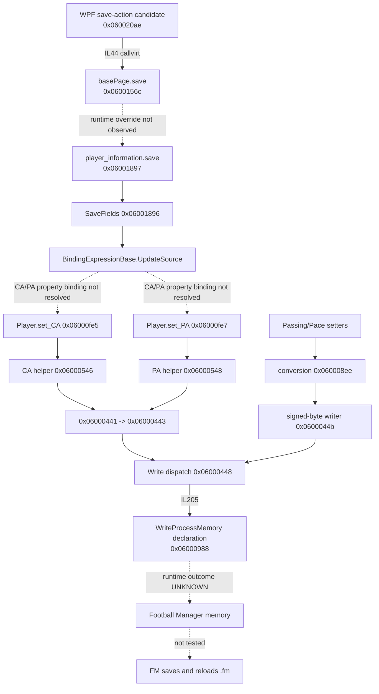

# FMRTE 13 — Save Changes and deepest recovered write boundary

**Target identity:** FMRTE.exe 13.3.3.62, x86 .NET Framework 4 Client, C:\BraCa Soft\FMRTE 13\FMRTE.exe, SHA-256 c3d594ed4d9d2c50e987a36ed186d771dd4242450c7e75fc34920e5d8dbcfcae, MVID 3a4eebcf-0c16-4aa7-9cf2-ae0de96d1ec6. **No write or game launch was performed.**

Use UI13, P13, CA13, M13, A13 and B13 aliases from the [load report](01-fmrte13-load-pipeline.md). PG13 is ev_3158299bfb3444ec8d3dc061cfe303cbd5eb84eaf52a288a7611024088db2aa4, exact basePage + player_information selection.

## Save action, change tracking and validation

**CONFIRMED:** WPF method 0x060020ae, RVA 1118192, obtains get_paginaActual then issues callvirt basePage.save 0x0600156c at IL44. **INFERRED:** save-action dispatch. Its exact toolbar binding was not recovered. A virtual reference to the base declaration does not prove which override executes.

**CONFIRMED:** player_information.save 0x06001897, RVA 727120, calls SaveFields 0x06001896 and specific Person/Player setters. SaveFields walks the visual tree recursively, obtains binding expressions (IL86), and calls BindingExpressionBase.UpdateSource (IL101). UI-loading method 0x06001895 sets DataContext/Binding/UpdateSourceTrigger repeatedly, and calls Player.get_CA/get_PA. **INFERRED:** explicit binding-source commits form part of edited-field submission. **UNKNOWN:** precise binding property names for CA/PA and a proven end-to-end UpdateSource -> CA/PA setter invocation.

No verified original-value journal, global changed-field set, complete per-field range/dependency validation or transaction rollback was recovered. Do not infer these from SaveFields. save contains TryParse and equality checks for some other fields, not proof of CA/PA range validation.

## Confirmed setter paths

| Finding | Static location | Meaning and limit |
|---|---|---|
| RE13-W01 | Player.set_CA 0x06000fe5, RVA453712, IL17 -> 0x06000546 | i2 input forwarded through CA helper; runtime-selected destination unknown |
| RE13-W02 | Player.set_PA 0x06000fe7, RVA453792, IL17 -> 0x06000548 | Distinct helper/static fields; not evidence of same native offset |
| RE13-W03 | CA/PA helpers -> 0x06000441 -> 0x06000443 -> 0x06000448 | Typed Int16-oriented byte packing path; obfuscated branches/gates still apply |
| RE13-W04 | 0x06000448, RVA160944, IL205 -> 0x06000988 | Direct CIL call to WriteProcessMemory P/Invoke, not merely an import |
| RE13-W05 | 0x06000448 IL114–190 | Contains current GameProcess/HasExited/Pointer reads and opaque guards before write site; no guard was evaluated or disabled |
| RE13-W06 | Passing.set 0x060012e7 and Pace.set 0x06000fc2 | i1 input -> conversion 0x060008ee -> signed-byte writer 0x0600044b -> 0x06000448 |

M13 0x06000443 allocates a two-byte array and packs bytes; 0x0600044b packs a single signed byte. The full packing, argument checks and per-build destinations require separate semantic validation. No FM formula, safe range or production write support follows from this static width observation.

## Static graphs

Solid edges are actual reference edges. Dashed edges are unverified dispatch/binding links, not calls recovered by REA.

**CONFIRMED:** the deepest file-backed managed site references WriteProcessMemory. The import itself has RVA0 (external declaration), parameters native-int, native-int, u1[], u4, native-int&; i4 return. **UNKNOWN:** actual process, target address, byte-count/result handling in all branches, effects on game, native implementation and disk persistence. A native provider was unavailable.

## CA/PA and attribute behavior

**CONFIRMED:** CA and PA have separate helpers with Int16 signatures. Passing/Pace use signed-byte reads/writes plus transformations. **UNKNOWN:** whether changing CA triggers attribute normalization, when balancing occurs, constraints on negative PA, hidden-attribute/position side effects, and whether all setters follow the same guard semantics.

The UI path commits bindings and also calls other setters directly. This prevents a simplistic claim that all edits are a single serialized batch. No full dirty-field transaction or atomicity has been established. Protected/opaque checks were left intact.

## Persistence and safety results

| Experiment | Result |
|---|---|
| Close FMRTE after an edit | UNKNOWN / NOT RUN |
| Reload player / repeat read | UNKNOWN / NOT RUN |
| Advance FM time | UNKNOWN / NOT RUN |
| Save from FM, exit/reopen and reload | UNKNOWN / NOT RUN |
| Restore original state after partial write | UNKNOWN / NOT RUN |

**INFERRED:** a successful live-memory edit needs Football Manager's own persistence path to survive a reload. Current [official FMRTE26 instructions](https://docs.fmrte.com/getting-started/first-edit/) explicitly describe saving in FM; those docs are context for 26 and do not constitute an FM2013 persistence test.

ManagerHub writeback remains **UNSUPPORTED**. Exact-build verified reads, entity identity, write opt-in, before/after values, stale-session checks, independent readback, in-game reload and tested recovery are still required. No process-memory operation was added to the web app.
