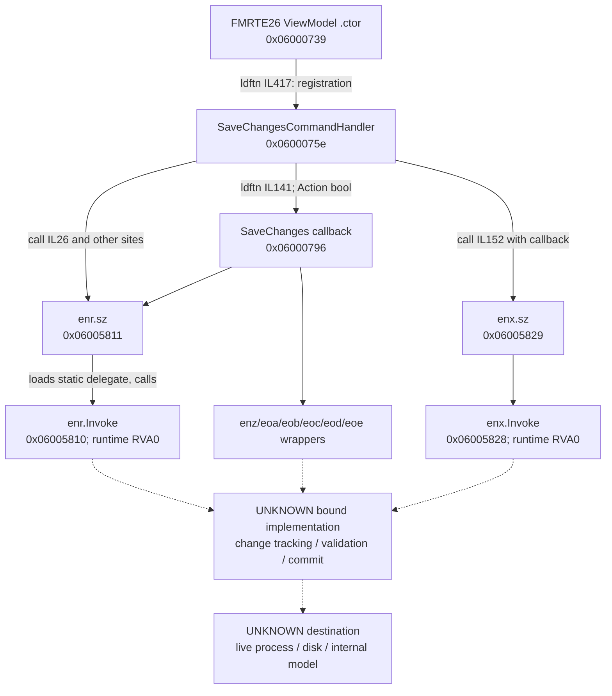

# FMRTE 26 — Save Changes: recovered static path

Research date: 2026-10-30. **The Save Changes UI and delegate-dispatch boundary are confirmed; the actual game write operation and persistence remain UNKNOWN.** This is secondary FMRTE26 evidence, not an FM2013 writer implementation.

## Identity and scope

Primary examined module: `<FMRTE26_INSTALL_ROOT>\current\FmrteAvalonia.dll`; file version `26.3.2.42`, assembly version `26.3.2.0`, MVID `ae81bf4d-f887-2214-dad5-9a575848146b`, AnyCPU CIL, .NET 9. SHA-256: `c763b9614e98f13a16f1b49b4a14ad191fc585627919fbac165970938d425ecf`.

REA 6.7.0 `rea-dotnet-static` v1 inspected metadata and file-backed CIL without loading or executing the target. Evidence aliases and the outside-repository bundle location are defined in [the FMRTE26 load report](01-fmrte26-load-pipeline.md): VM26 `ev_282883d732782d257fefdd6e8241cedc787851ec60cc7c49bb6fb4b9589c5550`, W26 `ev_2341019003d68f8c2d501a5614afbea4b408fbe8c6e8ba6ee32408c4adf4b57c`, B26 `ev_ee75015b533bdbc0b4ca2202c1c9f87ae75a0f1fe1b8ebe5c93200b505a44cc6`. Native providers were unavailable. No user save or live game process was changed.

## Confirmed command and delegate references

| Finding | Confidence | Build-local location | Observation and practical limit |
|---|---|---|---|
| RE26-W01 | CONFIRMED | ViewModel `.ctor` `0x06000739`, RVA `0x1078d8`, IL `417`; VM26 | Contains `ldftn` for `SaveChangesCommandHandler`, followed by `Action` construction. Handler registration is visible; command execution was not observed. |
| RE26-W02 | CONFIRMED | `SaveChangesCommandHandler` `0x0600075e`, RVA `0x108e60`, file offset `1077344`; VM26 | A file-backed method with 359 CIL bytes and calls to delegate wrappers. It loads the existing `gameContext` field `0x0400017b`. |
| RE26-W03 | CONFIRMED | Handler IL `26`, `52`, `186`, `210`, `247`, `335`; VM26/W26 | Calls `enr.sz` `0x06005811` at several static sites. `enr.sz` loads delegate field `0x04001ee0` and invokes `enr.Invoke` `0x06005810`; its bound operation is not resolved. |
| RE26-W04 | CONFIRMED | Handler IL `141`, `147`, `152`; VM26 | Contains `ldftn` for `<SaveChangesCommandHandler>b__201_0` `0x06000796`, constructs `Action<bool>`, and calls `enx.sz` `0x06005829`. This confirms an available callback path, not that the callback was executed or that it authorizes a write. |
| RE26-W05 | CONFIRMED | Callback `0x06000796`, RVA `0x10c344`, file offset `1090884`; VM26/W26 | Has 229 CIL bytes. Loads `gameContext` and calls `enr.sz`, `enz.sz`, `eoa.sz`, `eob.sz`, `eoc.sz`, `eod.sz`, `eoe.sz`, among other wrappers. It does not expose a verified game-memory destination. |
| RE26-W06 | CONFIRMED | `enr.Invoke` `0x06005810`; W26 | Runtime-provided delegate Invoke, RVA 0, no file-backed CIL. This is the deepest confirmed invocation boundary for the illustrated branch, not a confirmed write API. |

Normalized CIL digests: handler `b2898a0174c4cfa57fd7f39011b5f3b514ecad2b1d0909003b2aa0b68eaa0ad6`; callback `87a234f3c7b16aef52f7c22b943cd4cd7e830d6662139f5b826652f21237cc31`. Tokens and IL offsets are not game-memory addresses.

## Reproducible graph

Solid arrows are observed static CIL reference edges. `ldftn` is a method-address reference, not a normal direct call; a runtime delegate's bound method remains unresolved. No execution order or branch reachability is inferred from the list of sites.

The callback graph describes references present in CIL; it is not evidence that `enx` actually invokes the callback. Wrapper static constructors call obfuscated resolution helpers. Their target binding was not evaluated; protections and license checks were not patched or bypassed.

## Field changes, validation, and CA/PA

| Required question | Result | Reason / evidence boundary |
|---|---|---|
| Edited-field tracking and original-value capture | UNKNOWN | No corresponding framework implementation was recovered. A ViewModel setter or Save Changes name is insufficient. |
| Target entity verification | UNKNOWN | No verified native player identity or destination pointer was recovered. |
| CA/PA range validation and serialization | UNKNOWN | CurrentAbility/PotentialAbility MemberRefs observed in advanced-search ViewModels are search interfaces, not proof of the player's storage layout or write validation. |
| Attribute versus CA/PA write paths | UNKNOWN | No value-to-destination write mapping was recovered. |
| CA-triggered normalization/recalculation | UNKNOWN | No actual game-engine behavior was observed. |
| Position and hidden-attribute writes | UNKNOWN | No verified field offsets or encoding were established. |
| Final native API | UNKNOWN | B26 declares `LoadLibrary`/`GetProcAddress` only. Dynamically resolved functions or other modules may supply additional behavior; no native provider established them here. |

**CONFIRMED:** the assembly-wide MemberRef inventory references `Fmrte.Mvvm.Interfaces.ISavableView.SaveViewChanges` (`0x0a000dd5`, returns string), `TabbedViewModel.SaveCurrentTab` (`0x0a001163`, returns string), and `Config.get_ShowSaveChangesWarning` (`0x0a001169`, returns bool). These are referenced interface declarations. They do not demonstrate that the illustrated obfuscated wrappers target those members, or establish a successful commit. `Config.Save` also exists as a reference; saving application settings must not be conflated with saving a Football Manager game.

## Persistence and technology distinction

All lifecycle results below remain **UNKNOWN / NOT TESTED**: closing FMRTE, refreshing the player, advancing game time, saving from Football Manager, exiting/reopening Football Manager, and loading the resulting `.fm` file. There is no controlled before/after test or game-reload result in this investigation.

The binary evidence establishes the command and context/delegate dispatch. It does **not** establish whether this command writes game process memory, an internal model, a save file, or several of these. Any official documentation statement about live editing must be cited separately and must not upgrade this incomplete binary call graph into an observed memory-write trace.

ManagerHub must retain independent capabilities for live access and offline file rewriting. No editor capability can be enabled from this evidence. Readback, exact-build/entity checks, original-value capture, explicit opt-in, bounded writes, structured errors, and rollback are **ManagerHub design requirements**, not recovered FMRTE implementation claims.

## Next verification

1. Recover the legitimate framework implementation identity and delegate binding without bypassing protection/licensing.
2. Verify a read path for a known entity and exact game build before any write trial.
3. In a disposable, backed-up authorized corresponding-game save, observe one permitted field change through the actual Save Changes command, read back memory state, then save/reload in the game and verify persistence.
4. Test CA, PA, one visible attribute, and positional familiarity separately; no normalization formula or cross-version equivalence is assumed.
