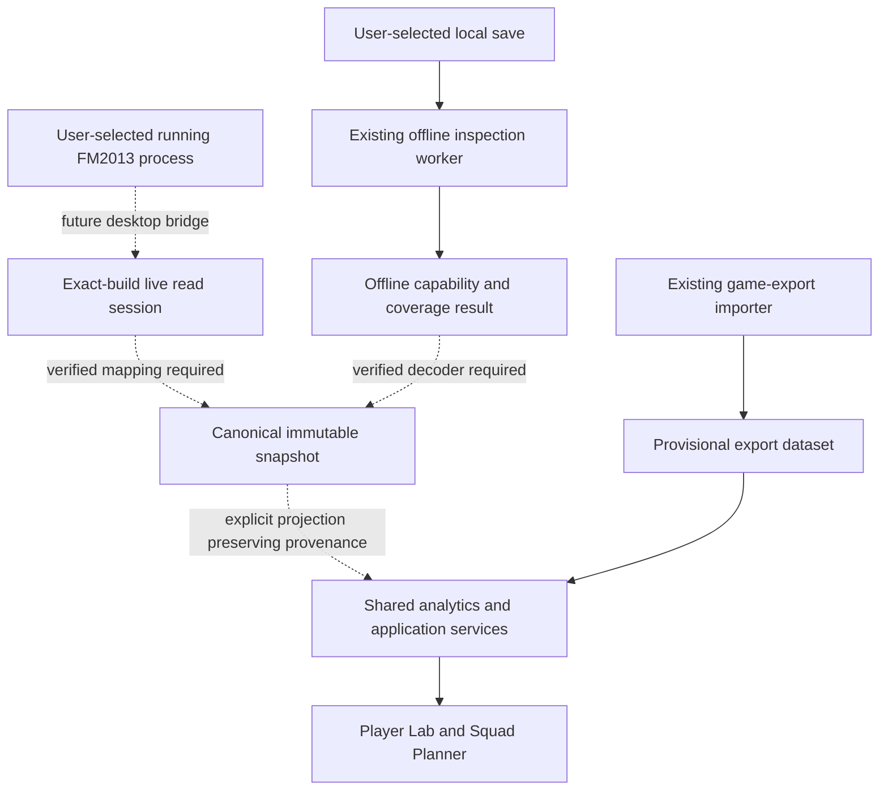

# ManagerHub data-access design after FMRTE research

Investigation date: 2026-10-30 (Asia/Bangkok). **Result: preserve the existing application; native FM2013 access remains a separately verified future integration.** Source-code observations below are CONFIRMED within the inspected checkout. Proposed boundaries are marked INFERRED design choices, not recovered FMRTE implementations.

## Existing implementation and reuse

| Area | Classification | Existing source and consequence |
|---|---|---|
| Application stack | CONFIRMED | `package.json` and `apps/web/package.json` define the React/Vite/TypeScript workspace. No Cargo/Tauri backend was found in the working tree. Tauri/Rust in `docs/system/02-architecture-and-deployment.md` is a target architecture, not implemented process access. |
| Offline inspection | CONFIRMED | `packages/domain/src/save.ts` implements local signatures, bounded archive observations and optional SHA-256. Its output remains `signature_only` or `unrecognized`, with unknown edition/build. Reuse these detectors; do not upgrade their results to player-data support. |
| Worker boundary | CONFIRMED | `apps/web/src/inspect-save-in-worker.ts` dispatches inspection to a worker, cleans it up on completion/error and falls back when Worker is unavailable. It does not implement native-process access. |
| Canonical evidence primitive | CONFIRMED | `packages/domain/src/types.ts` defines `EvidenceField<T>` with nullable value, source, verification, edition/build and missing reason. Reuse and extend this primitive when real native fields become available. |
| Export model | CONFIRMED | `packages/domain/src/player-import.ts` defines `PlayerExport` with `source:'game_export'` and `verification:'provisional'`; `PlayerDataset` fixes actual-CA/PA availability to `false`. `packages/domain/src/player-library.ts` validates those literals at persistence. These contracts must continue to mean exported observations. |
| Player Lab / Squad Planner | CONFIRMED | `apps/web/src/App.tsx` shares the same export dataset between both workspaces. Existing `AttributeKey`, player analysis and squad optimization can be reused through a deliberate projection. They do not supply a verified native identity or exact CA/PA. |
| Native snapshot model | CONFIRMED as a spec only | `docs/system/03-domain-schema-and-provenance.md` specifies `GameSnapshot` and `careerId + nativeId`. This is a design requirement; a native reader returning that verified snapshot has not been implemented. |
| Production read/write eligibility | UNSUPPORTED | This investigation has not verified a real ManagerHub player/CA/PA decoder or writer against an exact FM2013 build. No supported build should be added from static FMRTE calls alone. |

## Proposed integration boundaries

**INFERRED design choice:** keep one shared domain and React UI. An eventual desktop shell supplies a narrow local IPC boundary for live access; offline parsing stays in the bounded file-ingestion path. Do not add a server or second competing backend merely to host experimental offsets.

Dashed edges are **UNKNOWN/unimplemented capabilities**, not verified FMRTE calls. The graph contains no enabled write path.

The first native integration should expose source discovery, exact-build validation, a read-session lifetime and field coverage. UI code must receive structured results rather than process handles, raw addresses or arbitrary read/write commands. Reuse `EvidenceField<T>` and `AttributeKey`; introduce a new source kind for verified live-game observations only when the actual IPC/snapshot contract is implemented. `decoded_save` must continue to mean on-disk decoding.

The native snapshot needs the game edition/build, executable hash, adapter version, source/session identity, capture time, career lineage and native entity ID. Per-field evidence also needs the observed scale and missingness. A process ID is not a persistent identity, and two players with matching names are not a cross-career match. Unknown Actual CA/PA remain `null`; Role Fit, attribute-strength index, eCA and hypothetical edits retain their separate metric/source semantics.

**INFERRED design choice:** normalize once into the canonical snapshot and project only the verified visible fields required by existing analytics. Do not cast a live snapshot to `PlayerDataset`, weaken its export-only persistence checks, or mark its literal `actualCaAvailable:false` as `true`. A genuine snapshot integration requires coordinated model, storage, UI, VI/EN copy and regression changes.

## Compatibility, errors and lifecycle

**INFERRED requirements grounded in existing safety policy:**

- Track live-read, live-write, offline-read and offline-write compatibility independently, keyed by edition, exact build, executable identity, platform and adapter revision. An untested build has no verified read/write capability.
- Distinguish unsupported source/build, process not found, access denied, process closed, stale snapshot, corrupt data, missing field and interrupted read. Do not silently substitute another build's layout or an estimate.
- Own and close native handles inside a read session. Bound counts, pointer arithmetic, byte lengths, runtime and allocation. Check entity identity and source stability before publishing a snapshot; reject partial races rather than mixing two game states as one verified capture.
- Report `not_decoded` separately from `not_present` and `incompatible_build`. Realism Mode filters hidden fields before analytics, search, export and AI context, not solely in the visible UI.
- Keep source bytes, saves and process observations local; no implicit upload. Persist normalized snapshots only after a schema and privacy review appropriate to that source.

## Separate writer gate

**CONFIRMED policy:** `AGENTS.md`, `.agents/skills/managerhub-save-safety/SKILL.md` and `docs/system/05-player-editor-ca-pa.md` require independently validated writing. **UNKNOWN:** the actual invariants, recalculation rules and persistence behavior for the local FM2013 build, because no such build has been validated here.

**INFERRED future transaction contract:** exact supported build and write opt-in; verified entity; original-value capture; input/dependency validation; preview; stale-state check; controlled write; read-after-write; semantic diff; structured audit; recovery. For an offline writer, use immutable original, backup and a temporary new file, independent reparse and actual Football Manager load/rollback. For a live writer, a file backup alone cannot roll back the process: capture original live values, check the same session/entity before every write and test recovery from partial writes. Game-save persistence requires a separate game save/reload test. None of these steps is satisfied merely by finding `WriteProcessMemory`.

## Minimum implementation evidence

| Next work | Classification now | Exit evidence before enabling |
|---|---|---|
| FM2013 source/build detection | CONFIRMED executable metadata/hash only; runtime detection UNKNOWN | [Local executable identity](10-local-fm2013-executable.md) is now recorded; controlled successful/failed process/build detection tests remain needed. |
| Read-only player identity | UNKNOWN | Known native ID, name and club cross-checked on disposable same-build data; repeat reads and process-exit behavior. |
| CA/PA and attribute normalization | UNKNOWN | Verified per-field mapping, scales, known values, missing-field behavior and repeatability. No fabricated memory fixtures can establish game support. |
| Shared UI integration | INFERRED design | Canonical snapshot plus provenance-preserving projection; Realism/Editor modes and VI/EN missing/unsupported states tested. |
| Writeback and persistence | UNSUPPORTED | All transaction safeguards, independently verified reads, disposable-state edit/reload and recovery tests. |

The immediate usable output of this research is the source/evidence inventory, recovered static boundaries, explicit compatibility limits and reproducible inspection tooling. A fictional adapter or empty backend would not add verified capability. The full 27-module, seven-phase product strategy is preserved.
