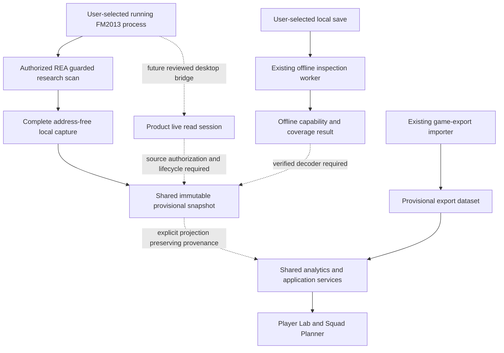

# ManagerHub data-access design after FMRTE research

Updated 2026-11-01 (Asia/Bangkok). **Result: preserve the existing application and use the implemented provisional live-snapshot contract as a research boundary. Product native access remains a separately reviewed integration.** Source-code observations are CONFIRMED within this checkout; proposed product boundaries remain design choices, not recovered FMRTE implementations.

## Existing implementation and reuse

| Area | Classification | Existing source and consequence |
|---|---|---|
| Application stack | CONFIRMED | `package.json` and `apps/web/package.json` define the React/Vite/TypeScript workspace. No Cargo/Tauri backend was found in the working tree. Tauri/Rust in `docs/system/02-architecture-and-deployment.md` is a target architecture, not implemented process access. |
| Offline inspection | CONFIRMED | `packages/domain/src/save.ts` implements local signatures, bounded archive observations and optional SHA-256. Its output remains `signature_only` or `unrecognized`, with unknown edition/build. Reuse these detectors; do not upgrade their results to player-data support. |
| Worker boundary | CONFIRMED | `apps/web/src/inspect-save-in-worker.ts` dispatches inspection to a worker, cleans it up on completion/error and falls back when Worker is unavailable. It does not implement native-process access. |
| Canonical evidence primitive | CONFIRMED | `packages/domain/src/types.ts` defines `EvidenceField<T>` with nullable value, source, verification, edition/build and missing reason. The research contract reuses it with source `live_game`, distinct from `decoded_save`. |
| Export model | CONFIRMED | `packages/domain/src/player-import.ts` defines `PlayerExport` with `source:'game_export'` and `verification:'provisional'`; `PlayerDataset` fixes actual-CA/PA availability to `false`. `packages/domain/src/player-library.ts` validates those literals at persistence. These contracts must continue to mean exported observations. |
| Player Lab / Squad Planner | CONFIRMED | `apps/web/src/App.tsx` shares the same export dataset between both workspaces. Existing `AttributeKey`, player analysis and squad optimization can be reused through a deliberate projection. They do not supply a verified native identity or exact CA/PA. |
| Native research snapshot | CONFIRMED implementation | `packages/domain/src/live-snapshot.ts` admits an address-free exact-build payload into an immutable provisional `GameSnapshot`. Real normalization succeeds on4,058 records; career identity remains user-declared and player keys snapshot-scoped. |
| Production read/write eligibility | UNSUPPORTED | Exact-build live reads and limited reference matches are demonstrated research. Product source discovery, desktop IPC, storage/projection/UI and broader validation remain incomplete. No writer was executed or certified. |

## Proposed integration boundaries

**INFERRED design choice:** keep one shared domain and React UI. An eventual desktop shell supplies a narrow local IPC boundary for live access; offline parsing stays in the bounded file-ingestion path. Do not add a server or second competing backend merely to host experimental offsets.

Dashed edges are **UNKNOWN/unimplemented capabilities**, not verified FMRTE calls. The graph contains no enabled write path.

The first product native integration should expose source discovery, exact-build validation, read-session lifetime and field coverage. UI code receives structured results rather than handles, addresses or arbitrary memory commands. The implemented contract adds `live_game` without claiming verified observations; `decoded_save` remains on-disk decoding. Its source-era attribute catalogue requires an explicit edition-aware projection before reusing current analytics keys.

The research snapshot retains edition/build, declared executable hash/PID, reader revision, capture time and native IDs. It explicitly reports unauthenticated runtime image bytes, caller-declared time/career and unverified roster completeness. PID is not persistent identity; names do not prove a cross-career match. Verified career lineage and source authorization remain product requirements. Unknown Actual CA/PA stay `null`; Role Fit, attribute-strength index, eCA and hypothetical edits retain separate semantics.

## Implemented local research contract

[The biography extension](22-fm2013-biography-cohort.md) now adds optional four-byte date and primary-nation observations to the existing version1 envelope. The compact v2 transport retains v1 extraction compatibility. Real replay normalizes4,058 dates/links; Editor keeps provisional values and Realism redacts supplied biography before returning the immutable snapshot. Missing/invalid dates remain unknown. Primary-nation relations do not become citizenship/ISO/eligibility facts, and no age is derived. These fields reuse the calendar helper and evidence primitive; production storage/UI/IPC integration remains a separate contract.

[The snapshot report](20-fm2013-live-snapshot-contract.md) documents the shared profile, strict parser, compact transport and Node file CLI. The complete real capture has 4,058 records, 49 ordinary fields and 15 position fields per record, with 3,730 source-qualified club links. Editor retains provisional ratings; Realism redacts all exact numeric ratings because scouting knowledge is not decoded. CA/PA and contract fields stay null in both modes.

The parser rejects incompatible declarations, extra/hidden fields, addresses, duplicates and inconsistent coverage. It returns frozen `ready`, `partial`, `empty` or `rejected` results; `ready` means admission only. The CLI reads through one bounded opened handle, decodes UTF-8 strictly, hashes input bytes and creates a fresh bounded JSON output without uploads or process APIs. This implements normalization, not a product desktop bridge or a capture-authentication service.

**INFERRED design choice:** normalize once into the canonical snapshot and project only the verified visible fields required by existing analytics. Do not cast a live snapshot to `PlayerDataset`, weaken its export-only persistence checks, or mark its literal `actualCaAvailable:false` as `true`. A genuine snapshot integration requires coordinated model, storage, UI, VI/EN copy and regression changes.

## Compatibility, errors and lifecycle

**INFERRED requirements grounded in existing safety policy:**

- Track live-read, live-write, offline-read and offline-write compatibility independently, keyed by edition, exact build, executable identity, platform and adapter revision. An untested build has no verified read/write capability.
- Distinguish unsupported source/build, process not found, access denied, process closed, stale snapshot, corrupt data, missing field and interrupted read. Do not silently substitute another build's layout or an estimate.
- Own and close native handles inside a read session. Bound counts, pointer arithmetic, byte lengths, runtime and allocation. Check entity identity and source stability before publishing a snapshot; reject partial races rather than mixing two game states as one verified capture.
- Report `not_decoded` separately from `not_present` and `incompatible_build`. Realism Mode filters hidden fields before analytics, search, export and AI context, not solely in the visible UI.
- Keep source bytes, saves and process observations local; no implicit upload. Persist normalized snapshots only after a schema and privacy review appropriate to that source.

## Separate writer gate

**CONFIRMED policy:** `AGENTS.md`, `.agents/skills/managerhub-save-safety/SKILL.md` and `docs/system/05-player-editor-ca-pa.md` require independently validated writing. **UNKNOWN:** actual write invariants, recalculation rules and persistence behavior for the local build; no write experiment was executed.

**INFERRED future transaction contract:** exact supported build and write opt-in; verified entity; original-value capture; input/dependency validation; preview; stale-state check; controlled write; read-after-write; semantic diff; structured audit; recovery. For an offline writer, use immutable original, backup and a temporary new file, independent reparse and actual Football Manager load/rollback. For a live writer, a file backup alone cannot roll back the process: capture original live values, check the same session/entity before every write and test recovery from partial writes. Game-save persistence requires a separate game save/reload test. None of these steps is satisfied merely by finding `WriteProcessMemory`.

## Minimum implementation evidence

| Next work | Classification now | Exit evidence before enabling |
|---|---|---|
| FM2013 source/build detection | CONFIRMED file identity plus runtime path/architecture/RTTI checks | Wider career/build/error-state checks and product source authorization; loaded image bytes remain unauthenticated. |
| Read-only player identity | CONFIRMED tested two-class cohort; general certification open | More references, career lineage, club semantics and real process-exit behavior. |
| CA/PA and attribute normalization | CONFIRMED original arithmetic, 49-field cohort reads and three-record reference matches | Broader references; no batch CA/PA publication. Synthetic fixtures alone cannot establish game support. |
| Snapshot normalization | CONFIRMED on the complete real capture | Further private replay, independent review and adversarial input coverage; no certification from declarations. |
| Shared UI integration | INFERRED design; unimplemented for live snapshots | Source-authorized IPC/storage, provenance-preserving projection and VI/EN missing/privacy states; scouting knowledge before Realism ratings. |
| Writeback and persistence | UNSUPPORTED | All transaction safeguards, independently verified reads, disposable-state edit/reload and recovery tests. |

Usable outputs include recovered boundaries, reproducible live discovery and the demonstrated local snapshot pipeline. Product integration, offline player decoding and writing remain distinct unfinished work. The full 27-module, seven-phase strategy is preserved.
