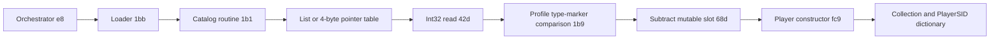

# FMRTE13 pointer catalogs and Player construction

**Later evidence:** [bounded player discovery](17-fm2013-bounded-player-discovery.md) traces the profile-dependent generic scan/group branch and repeatedly reads4,036 candidates through original research code. It supersedes this report's initial lack of runtime marker/identity observations. A fixed native global table and exact selected profile remain unresolved.

**CONFIRMED static pointer traversal and object construction; UNKNOWN applicability to the local running game.** Source: FMRTE.exe13.3.3.62, x86/.NET4, SHA-256 `c3d594ed4d9d2c50e987a36ed186d771dd4242450c7e75fc34920e5d8dbcfcae`, MVID `3a4eebcf-0c16-4aa7-9cf2-ae0de96d1ec6`. Main canonical evidence: `ev_7843e6956676f768833e4bb366ccf270166870709e4f9d79d0ff8398b232fa8c`. Exact type names/tokens/RVAs/body hashes are bound in [the manifest](evidence-manifest.json).

## Catalog loader

`0x060001b1`, RVA62216, has two observed address-source branches. One reads entries from a managed list; another reads Int32 from `tableBase + index * 4` via common helper `0x0600042d` at IL820. Both then read another Int32 at the candidate address (IL829) and compare that type marker with a descriptor supplied by profile interface `0x0600089c`, including descriptor field `0x04000668` for the Player branch.

The comparison helper `0x060001b9`, RVA66624, uses exact numeric equality when a profile Boolean is false. In its alternate branch it formats the two numbers using a string obtained through the obfuscated resolver, then tests StartsWith/EndsWith. The formatting string and native meaning of the markers remain unresolved; do not assume a universal vtable identity rule.

For a Player match, IL871–879 subtracts static slot `0x0400068d` from the candidate address and calls `Player::.ctor` (`0x06000fc9`). The result is added to collection `0x04000171` at IL893. A separate dictionary `0x04000172` maps `Person.get_PlayerSID` (`0x06000f65`) to `BaseObject.MemoryAddress`; ContainsKey at IL910 prevents duplicate dictionary insertion. **PlayerSID is not hereby established to equal Person.ID, an in-game unique ID or a stable export identifier.**

That loader is called by `0x060001bb` at IL154/548, `0x060001be` at IL776/1359 and `0x060001c0` at IL1856. Orchestrator helper `0x060000e8`, RVA34956, obtains the shared loader through `0x06000196` and calls `0x060001bb` at IL11. The exact UI/worker scheduling connection from load dispatcher `0x060000e6` to `e8` is still missing; no uninterrupted end-to-end UI trace is claimed.

The orchestrator and Player/Person were re-inspected together in canonical evidence `ev_bb47ef5af519919ba7155084e4d1bc121ff9df7cb076b9c42f863b1fb6f58f3c`; this independently retains `e8`, the Player constructor and PlayerSID accessor. Supplementary whole-assembly CIL cross-reference scans retain incoming callers outside the selected declaring types, with partial-coverage issues reported explicitly.

Short labels in the diagram are MethodDef row numbers, except `68d`, which denotes FieldDef `0x0400068d`. Every identity is scoped to the above binary. The list/table root and descriptors are supplied by profile-dependent paths; no validated FM2013 root address was recovered.

## Separate object resolver

`0x06000454`, RVA163384, is a different object-resolution routine. It obtains descriptors through `89c`, reads an address/type marker, then compares that marker with descriptor fields. On its Player branch, IL212–218 subtracts slot `0x0400068d` and constructs Player. Its PlayerStaff branch subtracts `0x0400014a` and calls `0x0600108b` at IL263. Other branches resolve agents, teams/clubs and existing cached objects. Static caller `0x0600044f` invokes it at IL240. This reinforces the distinction between object address, type marker and entity identity.

`0x06000149`, RVA47616, also constructs Player at IL124, but its surrounding body writes diagnostics. It was excluded from the main catalog graph: a constructor cross-reference by itself is not evidence that a method is the production loader.

## Boundaries of the result

No pointer table, marker, dictionary or PlayerSID was observed at runtime. No native snapshot was produced. The original research arithmetic can decode a supplied word at a supplied effective address; these recovered static catalog paths do not yet provide a trusted address for the user's save/game. Validate exact-build profile selection and a known player before connecting any of this to an import adapter.
