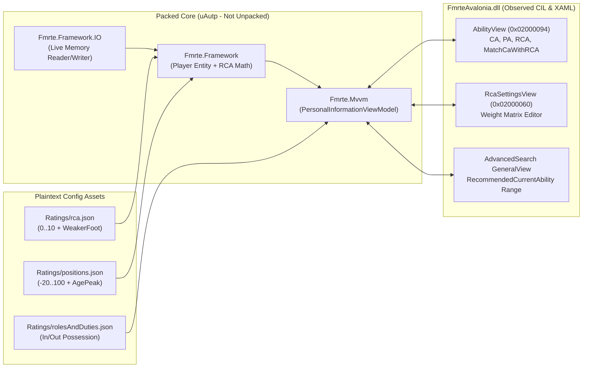

# FMRTE 26 Reverse Engineering Report

## 1. Executive Summary

This report documents the read-only reverse engineering of **FMRTE 26** (`26.3.2-build41`, managed assembly version `26.3.2.0` / file version `26.3.2.42`), cross-referenced against **FMRTE 13** (`13.3.3.62`), **Football Manager 2013** (`13.3.3f359652`), and **Football Manager 26** (`editor.fmf` / IL2CPP metadata) using the `reverse-engineer-anything` (REA `6.7.0`) toolchain.

### Key Architectural Findings

1. **Multi-Assembly .NET 9 Avalonia Architecture (`OBSERVED`):**
   - `<FMRTE26_INSTALL_ROOT>/FMRTE.exe` (`x86`, `628,704` B, SHA-256 `a0e41aabf3466b6609ad45407dc756a9355eb5acdd37175a223694bf28be1097`) is the outer launcher.
   - `<FMRTE26_INSTALL_ROOT>/current/FMRTE.exe` (`x64`, `383,968` B, SHA-256 `5513fe1be1179195a90b21c2087175d49e469d68cdf7a290a369105c3ab7a3fd`) is the .NET 9 native apphost loading `<FMRTE26_INSTALL_ROOT>/current/FMRTE.dll`.
   - `<FMRTE26_INSTALL_ROOT>/current/FMRTE.dll` (`x64` CIL, `12,328,416` B, MVID `c1d1bd13-5fbc-417d-40ad-2d18cd8973c8`, SHA-256 `29122b04bde4d77b5860423544d93f6bbef5b2e9c65b9a5749bd388c2be4b89e`) acts as the protected bootstrapper and assembly resolver.
   - `<FMRTE26_INSTALL_ROOT>/current/FmrteAvalonia.dll` (`AnyCPU` CIL, `19,534,816` B, MVID `ae81bf4d-f887-2214-dad5-9a575848146b`, SHA-256 `c763b9614e98f13a16f1b49b4a14ad191fc585627919fbac165970938d425ecf`) contains the complete Avalonia `11.3.10.0` UI layer (`5,850` `TypeDef` rows, `1,026` `TypeRef` rows, `5,280` `MemberRef` rows, `29,182` `MethodDef` rows) and references `Fmrte.Framework` (`26.3.2.0`), `Fmrte.Framework.IO` (`26.3.2.0`), `Fmrte.Mvvm` (`26.3.2.0`), and `Fmrte.Licensing` (`26.3.2.0`).

2. **Anti-Tamper & Licensing Boundary Compliance (`OBSERVED` / `UNKNOWN`):**
   - REA static inspection (`ev_a69502d7ebd23619ce3fcbf07621e7e0c915e45efda41eadd03e8e87ef16f105`) shows `FMRTE.dll` embeds an encrypted/compressed private manifest resource `uAutp` (`0x28000002`, `11,854,499` B, SHA-256 `b70449567f0baf5fb54eb4149ab41c8c5a6acec70cceae71af2e9d69148d0223`) alongside debugger/decompiler checks (`IsDebuggerPresent`, `CheckRemoteDebuggerPresent`, `CreateDecryptor`). `FmrteAvalonia.dll` embeds private string resource `bVew` (`0x28000007`, `4,247,747` B).
   - **Strict Engineering Compliance:** Per ManagerHub governance, **zero attempt was made to unpack `uAutp`, decrypt `bVew`, attach invasive hooks, or inspect `Fmrte.Licensing`**. All conclusions in this study derive strictly from shipped plaintext JSON/XML assets, unencrypted ECMA-335 metadata/CIL in `FmrteAvalonia.dll`, unencrypted `FMRTE 13`, and offline `.fm` / `.fmf` corpora.

3. **Three Separate Rating Subsystems in FMRTE 26 (`OBSERVED`):**
   - **RCA Weight Engine (`Ratings/rca.json`):** SHA-256 `a378c8e0be5e268dc7ed2a2b932ed9d478f135976c0bf45788f77294b63d4ffa`, `SettingsVersion: "24.4.0.35"`. Defines **CA-cost weights** (`0.0..10.0`) + `WeakerFoot.Weight` (`3.0..7.5`) across 10 positional archetypes. Edited in UI via `FmrteAvalonia.Views.Settings.Ratings.RcaSettingsView` (`0x02000060`) bound to `SettingsPageViewModel.get_RcaSettings` (`0x0a00065c`).
   - **Positional Suitability % Calculator (`Ratings/positions.json`):** SHA-256 `c1ee11733e8d76715a3d157f76e1742b8f4b6f2e22a11b9b54ada9891c7de675`, `SettingsVersion: "24.4.0.35"`. Defines `-20..100` suitability weights + `AgePeak` + `AbilityDependent: bool`. Identical in mathematical model to FMRTE 13 `Ratings/FMRTE.xml`. Edited via `PositionRateCalculatorSettingsView` (`0x0200005e`).
   - **Tactical Roles & Duties Highlight Schema (`Ratings/rolesAndDuties.json`):** SHA-256 `3652da78662d8f0da91e67a6d396f1b47ef6c76c306d20ec7cc2538c7f3fffbc`. Encodes FM26's new dual-phase (`InPossession` / `OutOfPossession`) key/preferable attribute highlights.

---

## 2. End-to-End FMRTE 26 Data & UI Flow

### Observed ViewModel & XAML Contract (`AbilityView`, Token `0x02000094`)

From REA `inspect_managed_members` (`ev_bdf1ea070b38a8c685160958522acf7fce6383af642029c8d8373c25e122580e` and `ev_a61d53d35232eb3beaf07b84804b1f99848c90deb30f32c4ab1acd5830f7eeb3`):

| MemberRef Token | Declaring Type & Member | Signature | Observed Role |
| --- | --- | --- | --- |
| `0x0a000900` / `0x0a000901` | `PersonalInformationViewModel::get_CA` / `set_CA` | `Int16` | Editable Current Ability (`1..200`) |
| `0x0a000902` / `0x0a000903` | `PersonalInformationViewModel::get_PA` / `set_PA` | `Int16` | Editable Potential Ability (`1..200` / negative youth ranges in pre-game DB) |
| `0x0a000904` | `PersonalInformationViewModel::get_AbilityDifference` | `string` (getter only) | Read-only formatted CA/PA or CA/RCA delta |
| `0x0a000905` / `0x0a000906` | `PersonalInformationViewModel::get_RCA` / `set_RCA` | `Int32` | Computed Recommended Current Ability (`TextBox.set_IsReadOnly(true)` in `AbilityView.!XamlIlPopulate` at IL offset `1490` via `0x0a000dfb`) |
| `0x0a000907` / `0x0a000908` | `PersonalInformationViewModel::get_MatchCaWithRCA` / `set_MatchCaWithRCA` | `bool` | Per-player toggle ("Match CA with RCA" in `english.xml` line 3788) |
| `0x0a0006e8` / `0x0a0006e9` | `AdvancedSearch.Players.GeneralViewModel::get_RecommendedCurrentAbility` | `RangeValues` | Min/max search filter over computed RCA |

---

## 3. Comparison with FMRTE 13 & Football Manager 26 Pre-Game Editor

- **FMRTE 13 (`13.3.3.62`, `ev_c8421357f4ab30ad6d10deef76764b37f98e186374efe5eb4a85ccaeb169b607`):** Contains `Match CA to PA` and positional suitability ratings (`Ratings/FMRTE.xml`), but **no RCA engine, no `rca.json`, and no `MatchCaWithRCA` toggle** (`OBSERVED`).
- **Football Manager 26 Official Pre-Game Editor (`shared/data/editor.fmf`, `OBSERVED`):** Decompressing the Zstandard (`0xFD2FB528`) `afe.` v8 archive reveals Sports Interactive's own internal database fourCC properties under `Ability and Reputation`:
  - `pers,PCAB` — Current Ability
  - `pers,ERCL` — Recommended Current Ability (`label`, comment: `"current ability level recommended based on player attributes"`)
  - `pers,PCRD` — `CA/RCA % Difference` (`debug_only="true"`)
  - `pers,PRDF` — `CA/RCA Difference` (`debug_only="true"`)
  - `pers,PPAB` — Potential Ability

This proves that **Recommended Current Ability (RCA)** originates conceptually from Sports Interactive's Pre-Game Editor attribute-cost balance check, while FMRTE 26 implements an **independent user-editable weight-table approximation** (`Ratings/rca.json`) because live saves store `CA` and `PA` but not pre-game `ERCL`.

---

## 4. Epistemic Summary & Remaining Unknowns

| Component | Status | Evidence / Reason |
| --- | --- | --- |
| FMRTE 26 `Ratings/rca.json` 10-archetype weights & zero-cost attributes | `OBSERVED` | Exact plaintext JSON (`a378c8e0...`) |
| FMRTE 26 UI/ViewModel property types & read-only RCA box | `OBSERVED` | `FmrteAvalonia.dll` MemberRefs & `AbilityView.!XamlIlPopulate` (`ev_bdf1ea07...`, `ev_a61d53d3...`) |
| Exact internal rounding / multi-position formula inside `Fmrte.Framework.dll` | `UNKNOWN` | Packed inside `uAutp` (`0x28000002`); deliberately not unpacked |
| Affine weighted-mean relationship between `rca.json` weights and FM2013 `Actual CA` | `INFERRED` | Historical universal/per-position fit claims not independently reproduced; see RCA validation report |
| Exact build-certified RCA auto-write for FM2013 `13.3.3f359652` | **Not `CERTIFIED`** | Kept fail-closed (`autoMatchAvailable: false`) in ManagerHub |
