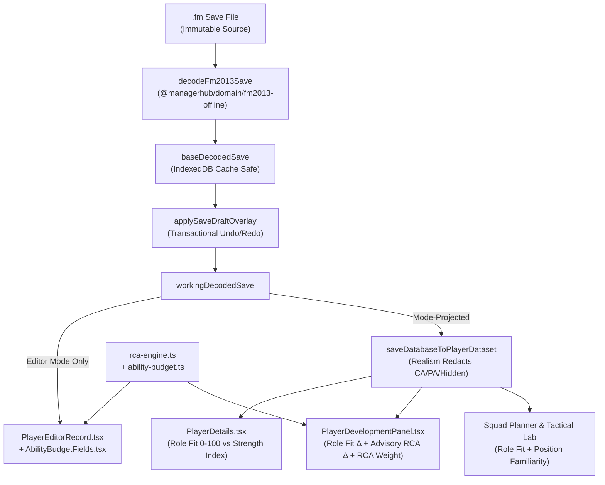

# ManagerHub Multi-Edition RCA Implementation Guide

## 1. Architectural Principles

ManagerHub integrates multi-edition RCA analysis directly into the existing `@managerhub/domain` and `@managerhub/web` workspaces **without creating duplicate packages, parallel stores, or fake certification states**:

1. **Single `.fm` Load → Unified `SaveSession`:** Loading one `.fm` file populates `baseDecodedSave` (immutable) + `editorState` (transactional draft overlay) → `workingDecodedSave`, which feeds Classic Editor, Player Lab, Development Simulator, Recruitment Preview, Squad Planner, and Tactical Lab simultaneously.
2. **Clean-Room Modular Domain Layer (`packages/domain/src/rca-*.ts`):**
   - `FMRTE26_RCA_ARCHETYPES` — Reference 10-archetype weights in rca-weights.ts; no affine coefficients.
   - `FM2013_RCA_EDITION_PROFILE` & `FM2026_RCA_EDITION_PROFILE` — Profiles in rca-editions.ts; separate historical FM2013-only affine coefficients. FM26 reference-only; SW accepted only for FM2013 as DC fallback. Unknown build/edition fails closed.
   - `evaluateFootAbility(...)` — Pure weaker-foot (`min(leftFoot, rightFoot)`), preferred-foot, and positional `WeakerFoot` cost evaluator.
   - `evaluatePlayerRca(player, options)` — Pure, deterministic, side-effect-free diagnostic engine.
   - `getAttributeRcaWeight(position, attribute, edition, build)` — Reference weight lookup (0–10 or null = unknown) for side-by-side display next to tactical Role Demand weights (`1..3`).
3. **Strict Domain Separation:**
   - **Native `Actual CA` / `PA` (`1..200`):** Decoded from `game_db.dat`, redacted in **Realism** mode, editable in **Editor** mode.
   - **Certified `Recommended CA` (`recommendedCa: null`):** Reserved strictly for future build-certified native parity; keeps `Auto match CA with RCA` fail-closed (`disabled`).
   - **Research `Advisory RCA` (`advisoryRca: 1..200`):** Shown transparently in **Editor** mode (`AbilityBudgetFields.tsx`) and **Development Simulator** (`PlayerDevelopmentPanel.tsx`) only with explicit Editor visibility context, with live recalculation on attribute/foot/position edits and `RCA > PA` warnings. Realism/export evaluators return no ability diagnostics.
   - **Tactical `Role Fit` (`0..100`):** Computed by `scoreRole` in `player-analysis.ts` from `FM2013_ROLES` demands; never conflated with CA/RCA.
   - **Development `Priority` (`gap × roleDemandWeight`):**Displayed alongside `RCA weight` (`0..10`) in `PlayerDevelopmentPanel.tsx` only in Editor mode; zero reference weights do not establish free native training.

---

## 2. Module Responsibilities & Data Flow

---

## 3. Adding or Certifying a Future Edition Profile

To register a new Football Manager edition (e.g., `FM2024` or a certified `FM2013` native formula):

1. **Collect primary evidence.** Record exact binary or asset digests and REA evidence IDs in the [research evidence index](RESEARCH-EVIDENCE-INDEX.md). Keep original artifacts in local evidence storage.
2. **Define `RcaEditionProfile`:** Specify `profileId`, `edition`, `supportedBuilds`, `positionsSupported`, `positionArchetypeMap`, and `positionFallbackNotes`.
3. **Keep `certifiedForAutoMatch: false` Until Proven:** Do not flip until independent exact-build numeric RCA observations, parity across positions/missingness/rounding, field-specific writer readback and game reload, consent gates and independent acceptance are all satisfied. Synthetic tests are insufficient.
4. **Preserve `PA` Immutability:** Even when `certifiedForAutoMatch` is enabled for a profile, `autoMatchDecision.preservesPa` **must remain `true`** — `Auto Match CA` updates draft `actualCa` only and never alters `potentialAbility`.
